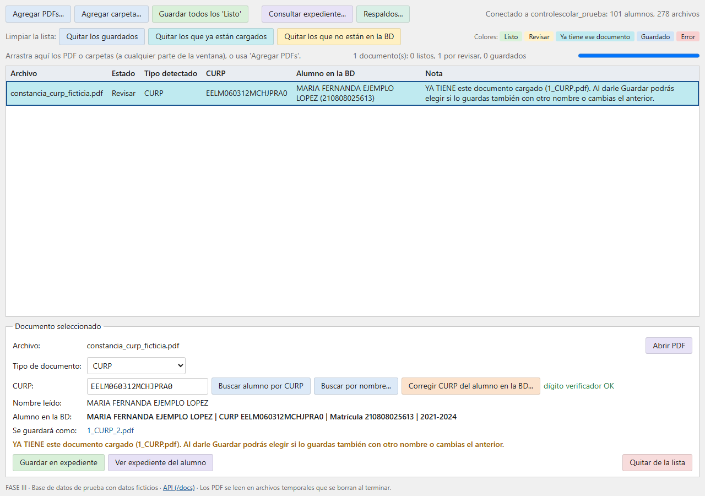
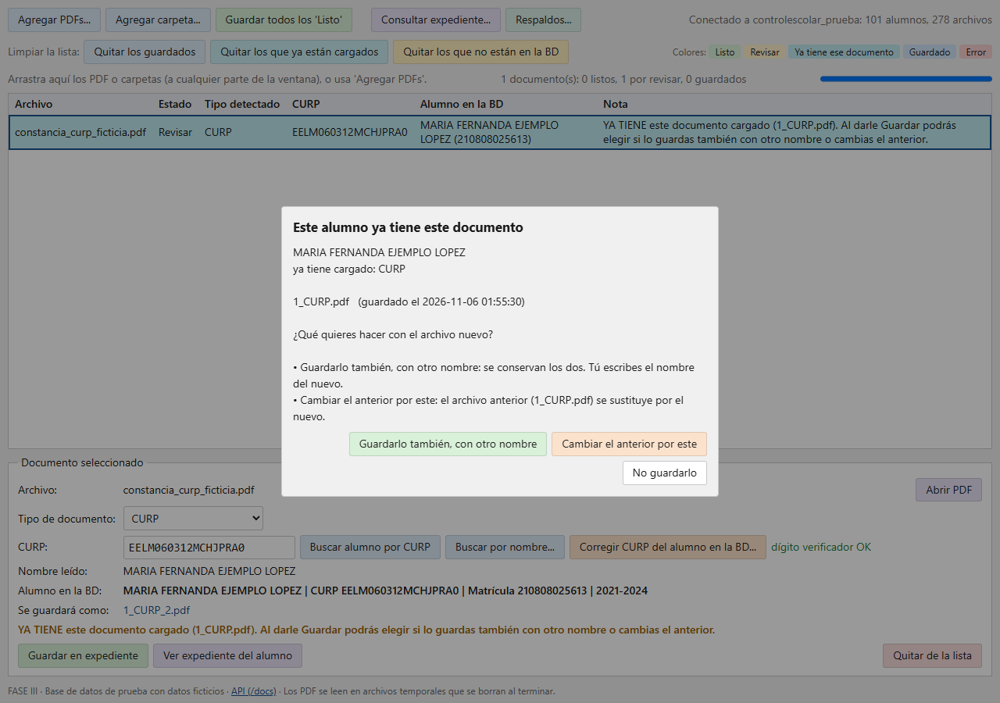
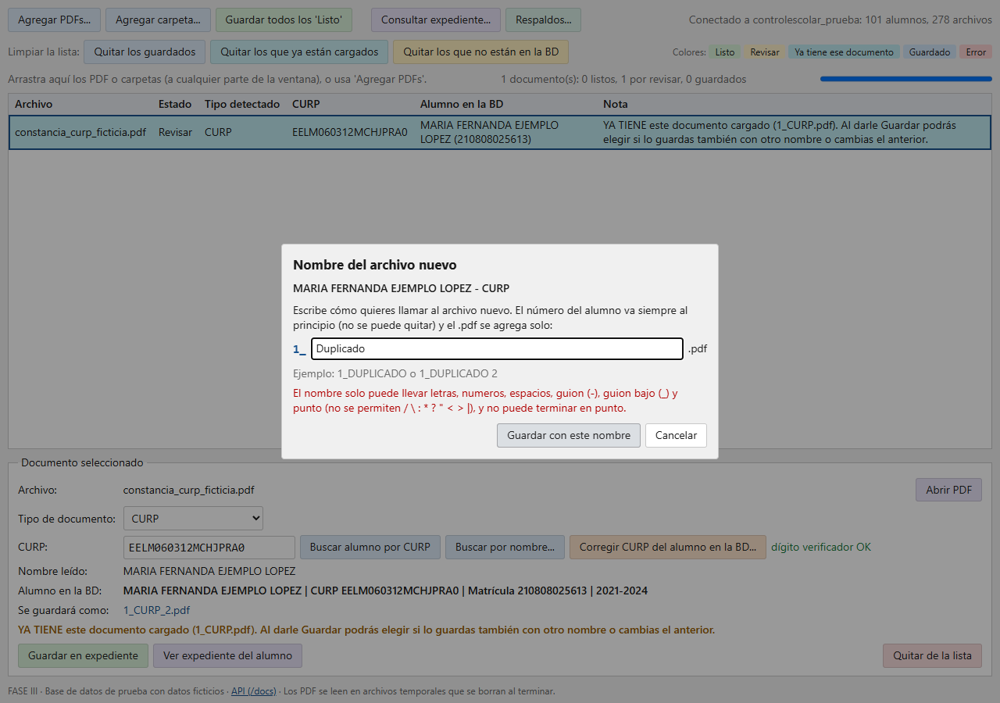
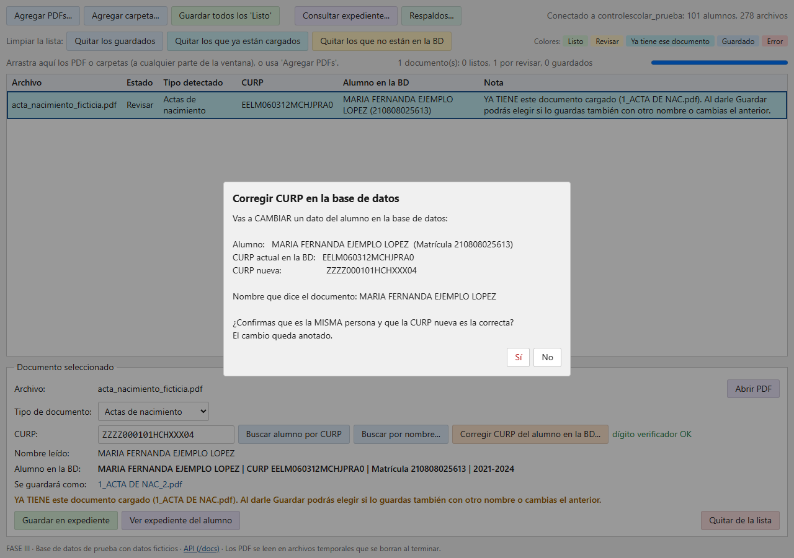
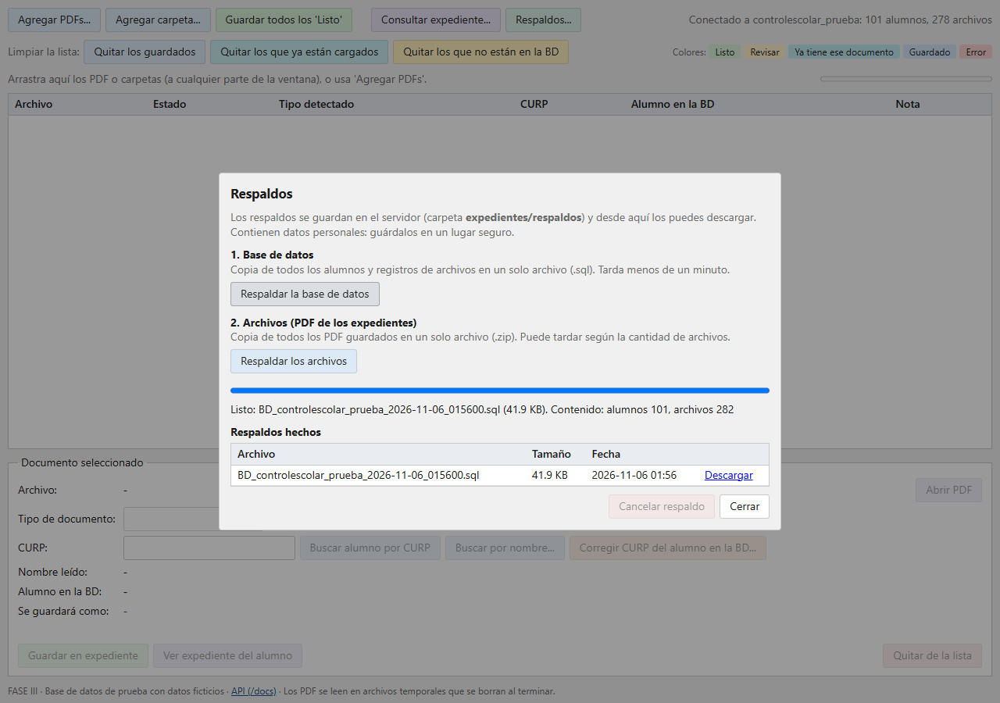
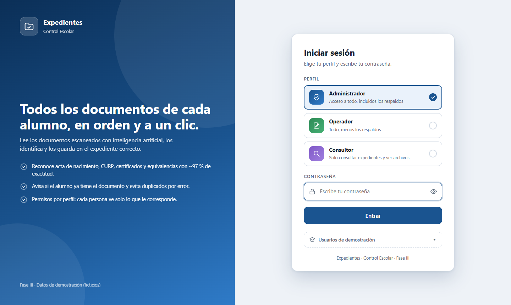
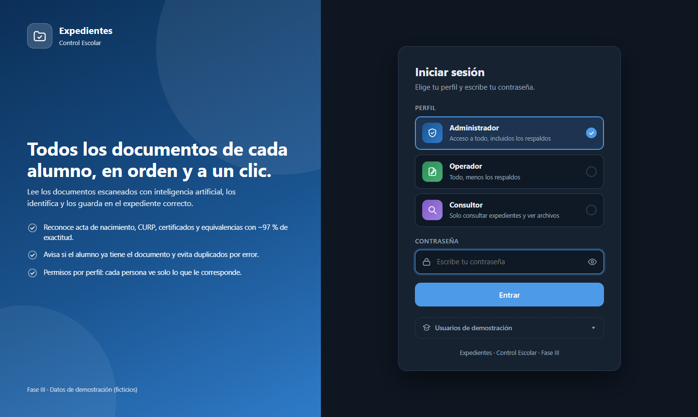
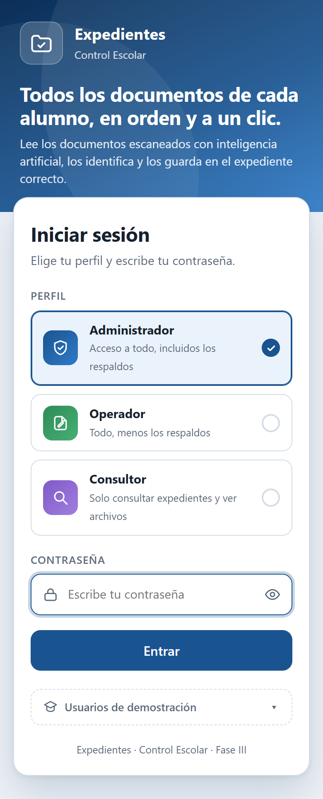
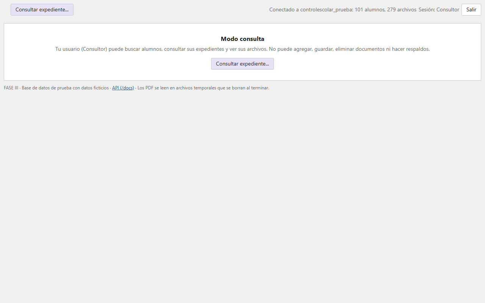
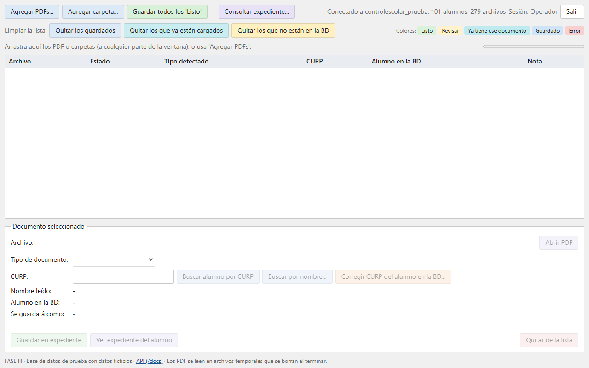

# Novedades de la Fase III (frente a la Fase II)

La Fase II dejó funcionando la versión web del *Sistema de Expedientes* con una base de datos de prueba. La Fase III **no
cambia el modelo ni el flujo base**: agrega las mejoras que salieron de usar el sistema de escritorio con la base real
(documentos duplicados, CURP mal escritas en la BD, listas largas que hay que limpiar a mano) y las que la Fase II dejó
pendientes (contraseña de acceso y permisos distintos, respaldos).

> **¿Dónde quedó la Fase II?** Este repositorio empezó como *FASE-II* y se renombró a *FASE-III*: conserva **todo el historial**.
> La entrega de la Fase II está marcada con la etiqueta **`fase-2`** (`git checkout fase-2`, o en GitHub: *Releases / Tags → fase-2*).
> Los enlaces antiguos a `FASE-II` siguen funcionando (GitHub redirige al nombre nuevo).

## Resumen

| # | Novedad | Para qué sirve |
|---|---|---|
| 1 | **Aviso de «ya tiene este documento»** al leer el PDF (fila **turquesa**) | Antes solo se descubría al pulsar *Guardar*; ahora se ve en la lista desde que se lee |
| 2 | **Duplicado con nombre**: el id del alumno va **fijo** al inicio | Los nombres escritos a mano (`Duplicado.pdf`) chocaban entre alumnos porque todos los PDF comparten una carpeta |
| 3 | Categoría **«Duplicado»** que se elige **a mano** | La IA nunca puede decir «duplicado» (el PDF de un duplicado no lo dice y se ve igual que un certificado de término) |
| 4 | Botones **Quitar los que ya están cargados** y **Quitar los que no están en la BD** | Limpiar la lista de golpe en vez de uno por uno |
| 5 | **Alumno por nombre sin CURP** deja de pedir revisión si el nombre coincide y la fecha concuerda | Muchas actas no traen CURP legible pero sí el nombre |
| 6 | **Corregir la CURP del alumno en la BD** | Hay CURP mal escritas en la base y por eso no se encontraba al alumno |
| 7 | **Respaldos** de la base de datos (.sql) y de los PDF (.zip) desde la pantalla | Respaldos manuales, con descarga |
| 8 | **Login con 3 roles**: administrador, operador y consultor | Cumple el pendiente «usuarios y permisos distintos»: el consultor solo consulta, el operador no respalda y el administrador lo hace todo |
| 9 | Botones con **tonos suaves de color** y leyenda de colores | Identificar más rápido para qué sirve cada botón |

## Detalle

### 1. «Ya tiene este documento» (fila turquesa)
Al terminar de leer cada PDF, el servidor ya devuelve los documentos del mismo tipo que el alumno tiene registrados
(`documentos_del_mismo_tipo`). La pantalla los usa para pasar el documento a **Revisar** con una fila turquesa distinta del amarillo
de «Revisar» y una nota que dice cuál archivo ya existe. Se vuelve a revisar si se cambia el alumno o el tipo a mano.



Al guardar aparece una ventana con tres opciones claras:



### 2. Duplicado con nombre (id fijo)
Si se elige *Guardarlo también, con otro nombre*, el número del alumno (`1_`) aparece fijo y no se puede quitar; la persona solo escribe el resto
(se propone `DUPLICADO`, luego `DUPLICADO 2`, etc.). El servidor lo **valida de nuevo**: vacío, símbolos prohibidos (`/ \ : * ? " < > |`),
más de 100 caracteres, sin el id del alumno o nombre ya usado (en la carpeta o en la BD) se rechazan con un mensaje claro.



### 3. Categoría «Duplicado»
Es un tipo más de la lista *Tipo de documento*, pero **no es una clase del modelo**: `/tipos` la marca `manual: true` y `/salud` no la lista entre las
categorías de la IA. Se guarda como `<id>_DUPLICADO.pdf` con tipo `DUPLICADO` (igual que los duplicados del sistema anterior), no cuenta como
«ya tiene este documento» y no se tiene en cuenta como documento faltante en el resumen del expediente.

### 4. Limpiar la lista
Una fila de botones, cada uno con el color de lo que quita: **guardados** (azul), **ya cargados** (turquesa) y **no están en la BD** (amarillo). Piden
confirmación mostrando la lista y **no borran nada** del expediente ni de los PDF originales.

### 5. Alumno por nombre sin CURP
Antes, todo alumno encontrado solo por nombre quedaba en *Revisar*. Ahora pasa a *Listo* solo si: el documento **no trae CURP**, el nombre coincide
casi completo **en los dos sentidos** (≥ 80 %) y, si se leyó la fecha de nacimiento, **concuerda con la CURP del alumno**. Si algo no cuadra
(nombre parcial, fecha distinta, CURP leída pero no registrada) sigue en *Revisar* y la nota dice por qué (`reglas.py`, con pruebas).

### 6. Corregir la CURP del alumno en la BD
`POST /alumnos/{id}/curp`. Exige una CURP con **formato y dígito verificador válidos**, que **ningún otro alumno** la tenga y que la CURP en la BD siga siendo
la que se vio (no pisa un cambio hecho por otra persona). Cada cambio queda en `registro_cambios_curp.csv` (fecha, usuario, alumno, CURP anterior y nueva).



### 7. Respaldos
La BD se exporta a un `.sql` con **una lectura consistente** (aunque otra persona esté guardando) y los PDF a un `.zip`; ambos se hacen en segundo plano con avance,
se pueden cancelar y se descargan desde la misma pantalla. Se guardan en `expedientes/respaldos`. Solo se habilitan si se define `RESPALDOS_DIR`.



### 8. Login con tres roles
Al abrir la página, si no hay sesión, aparece una **pantalla de inicio de sesión completa** (`/login`): panel de marca, tres tarjetas para elegir el perfil, contraseña con ojito para verla, mensajes de error claros (con aviso si hay demasiados intentos), modo oscuro y diseño para celular. Hay tres usuarios fijos:

| Usuario | Puede | No puede |
|---|---|---|
| **Administrador** | Todo, **incluidos los respaldos** | — |
| **Operador** | Subir y leer documentos, guardar (reemplazar o duplicado), limpiar la lista, corregir CURP, **eliminar documentos** y consultar | Respaldos |
| **Consultor** | **Consultar** expedientes y abrir sus PDF | Agregar, guardar, eliminar, corregir CURP y respaldos |







Lo que ve cada rol cambia: el **Operador** no tiene el botón *Respaldos…*; el **Consultor** entra directo a *Consultar expediente* y solo ve el panel de consulta.




**Los permisos se aplican en el servidor, no solo en la pantalla.** Cada ruta exige un permiso (`consultar`, `capturar` o `respaldar`); sin sesión responde `401` y con un rol
que no alcanza, `403`. Evidencia real:

```bash
curl -s -o /dev/null -w "%{http_code}" http://localhost:8000/tipos                      # sin sesión
401
curl -c cookies -H "Content-Type: application/json" -d '{"usuario":"consultor","clave":"consultor-2026"}' http://localhost:8000/api/login
{"usuario":"Consultor","rol":"consultor","permisos":["consultar"]}
curl -b cookies -X POST http://localhost:8000/respaldo/bd                               # el consultor intenta respaldar
{"detail":"Tu rol (Consultor) no tiene permiso para esto."}                              # 403
curl -b cookies "http://localhost:8000/alumnos?q=EJEMPLO"                               # pero sí puede consultar
200
```

Las contraseñas vienen de variables de entorno (`CLAVE_ADMINISTRADOR`, `CLAVE_OPERADOR`, `CLAVE_CONSULTOR`; texto o el hash `pbkdf2_sha256$...` del programa de escritorio).
`docker-compose.yml` trae contraseñas **de demostración** (están en el README) y deben cambiarse con datos reales. Cinco intentos fallidos bloquean la IP cinco minutos, y el nombre del usuario
queda en las bitácoras y en la descripción de cada archivo guardado.

## Cómo se comprobó

- **40 pruebas automáticas** (`docker compose run --rm api pytest -v`): las 17 de la Fase II más 23 nuevas (duplicados con nombre, categoría Duplicado, corregir CURP,
  respaldos, reglas de alumno por nombre y **roles**: matriz completa de permisos por rol con `401`/`403`, con y sin base de datos).
- **Prueba en navegador real** (Microsoft Edge): subir los PDF de ejemplo, ya cargado → turquesa, duplicado con nombre y errores de nombre, categoría Duplicado,
  los dos botones de limpiar, corregir CURP (y restaurarla), respaldo de la BD con descarga, y **entrar con los tres roles** (qué botones ve cada uno y que el servidor rechaza con `403` lo que no le toca). Se encontró y corrigió un error
  (con contraseña, la lista de tipos no cargaba tras entrar).

## Archivos que cambiaron

| Archivo | Cambio |
|---|---|
| `app/main.py` | Tipo Duplicado, modo `personalizado`, `/alumnos/{id}/curp`, respaldos, usuarios y roles, versión 3.0.0 |
| `app/almacenamiento.py`, `app/base_datos.py` | Nombre con prefijo, validación, `actualizar_curp`, usuario en bitácoras (mismo código que el programa de escritorio) |
| `app/respaldos.py` *(nuevo)* | Respaldo de la BD y de los archivos |
| `app/reglas.py` *(nuevo)* | Reglas de «alumno por nombre» |
| `app/static/index.html`, `app/static/login.html` *(nuevo)* | Pantalla principal (colores, ventanas nuevas, limpiar, respaldos, roles) y página de inicio de sesión |
| `docker-compose.yml`, `.env.example` | `RESPALDOS_DIR`, `CLAVE_*` (usuarios de la demo), imagen `fase3` |
| `tests/` | 23 pruebas nuevas (`test_roles.py` y `conftest.py` son nuevos) |

## Lo que sigue pendiente

Conectarlo a la base de datos **real** (hoy solo usa la de prueba), HTTPS, administrar usuarios desde la pantalla (hoy son tres fijos), respaldos programados y publicarlo en un servidor.
