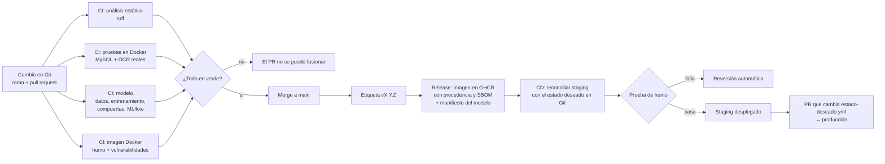

# Pipeline de IA (MLOps y GitOps) del Sistema de Expedientes

Este documento describe el pipeline automatizado del proyecto, **por qué** se tomó cada decisión técnica y **dónde están las evidencias** de que funciona.

## 1. Visión general



| Etapa | Archivo | Qué hace |
|---|---|---|
| Integración continua | `.github/workflows/ci.yml` | En cada push y pull request: análisis estático, pruebas, pipeline del modelo e imagen |
| Publicación versionada | `.github/workflows/release.yml` | Al crear la etiqueta `vX.Y.Z`: corre la CI, publica la imagen y crea la Release |
| Despliegue continuo | `.github/workflows/desplegar.yml` + `despliegue/` | Reconcilia el entorno con el estado deseado que vive en Git; prueba de humo y reversión |
| Pipeline del modelo | `pipeline/` | Validación de datos, entrenamiento, compuertas de calidad, MLflow y manifiesto con huellas |

## 2. Qué se automatiza (y cómo se prueba)

| Práctica | Implementación | Evidencia |
|---|---|---|
| **Integración continua** | `ci.yml`, 4 trabajos en paralelo | Pestaña *Actions* del repositorio |
| **Pruebas de código** | 51 pruebas en Docker con la base de datos y el OCR reales (`docker compose run --rm api pytest`) | Informe JUnit como artefacto + resumen del trabajo |
| **Pruebas de datos** | `pipeline/validar_datos.py`: esquema, nulos, clases esperadas, balance, longitud, duplicados y **ausencia de datos personales** | `pipeline/tests/test_pipeline.py` |
| **Pruebas de artefactos** | Huellas sha256 del modelo (`modelo/MANIFIESTO_MODELO.json`), vocabulario sin CURP, métricas contra compuertas, clases del modelo = clases de la aplicación, datos semilla válidos | `pipeline/tests/test_pipeline.py` |
| **Compuertas de calidad** | `pipeline/compuertas.json`: exactitud ≥ 0,95, F1 macro ≥ 0,95, peor clase ≥ 0,90, baja confianza ≤ 10 %, latencia ≤ 5 ms. Un modelo que no las cumple **detiene el pipeline** | Prueba `test_la_compuerta_de_calidad_detiene_un_modelo_malo` |
| **Versionado de modelos** | MLflow (seguimiento y registro con alias `candidato`), manifiesto por entrenamiento con commit, huellas y compuertas | Artefacto `artefactos-del-modelo` de cada ejecución |
| **Versionado de artefactos** | Imagen en GHCR con etiquetas semver (`1.0.0`, `1.0`), commit (`sha-…`) y `latest`; procedencia y SBOM; Release con el manifiesto del modelo | Página *Packages* y *Releases* |
| **Despliegue continuo** | `desplegar.yml` + `despliegue/reconciliar.py` | Ejecuciones del flujo *Desplegar* e historial en el resumen |
| **GitOps** | `despliegue/estado-deseado.yml` es la única fuente de verdad; se cambia con un pull request | Historial de Git del archivo |
| **Seguridad** | Escaneo de vulnerabilidades con Trivy en cada imagen; permisos mínimos por trabajo | Salida del trabajo *Imagen Docker* |

## 3. Decisiones técnicas y su justificación

| # | Decisión | Alternativas | Por qué |
|---|---|---|---|
| 1 | **GitHub Actions** como orquestador | Jenkins, GitLab CI | El código ya está en GitHub: cero servidores que mantener, gratis en repositorios públicos y las ejecuciones quedan visibles como evidencia |
| 2 | Las pruebas corren **dentro de Docker** con `docker compose run` | `pip install` en el ejecutor | Es el mismo entorno de producción (Tesseract, Poppler, MySQL 8): se evita el «en mi máquina funciona» y la CI ejecuta exactamente el comando del README |
| 3 | Pipeline del modelo con **datos sintéticos** en CI | Subir el dataset real | El dataset real contiene datos personales de estudiantes y **no debe salir de la institución**. Los datos sintéticos prueban el *pipeline* (validación, entrenamiento, compuertas, registro); el modelo de producción se entrena localmente con el dataset real usando el mismo script con `--permitir-curp` |
| 4 | **Compuertas de calidad** como código (`compuertas.json`) | Revisión manual de métricas | Un umbral escrito es auditable y repetible: el pipeline falla solo si el modelo empeora |
| 5 | **MLflow** para versionar modelos | Weights & Biases, DVC | Autoalojado (los datos no salen del equipo), con registro de modelos y alias; ya se usa en el monitoreo del proyecto |
| 6 | **Manifiesto con sha256** de los artefactos | Confiar en el nombre del archivo | Detecta que alguien cambió el modelo sin pasar por el pipeline; permite reproducir y auditar qué modelo corre |
| 7 | **Imagen en GHCR** con etiquetas semver + commit | Docker Hub | Integrada con el repositorio y los permisos; etiqueta inmutable por commit para trazabilidad y semver para humanos |
| 8 | **Procedencia y SBOM** en la imagen | Nada | Permite saber con qué se construyó y qué componentes lleva (cadena de suministro) |
| 9 | **Trivy** en modo informativo | Bloquear siempre | Muchas vulnerabilidades de la imagen base no tienen corrección; se reportan y se puede endurecer a `exit-code: 1` |
| 10 | **GitOps con estado deseado en un archivo** y reconciliación idempotente | Despliegue manual o `docker compose up` a mano | El estado del entorno queda en Git (revisado y con historial), se puede reconstruir y la reconciliación vuelve a ejecutarse sin efectos si ya coincide |
| 11 | **Prueba de humo + reversión automática** | Confiar en que arrancó | Un despliegue «verde» pero roto es peor que uno que falla: si no clasifica el documento de ejemplo, vuelve a la versión anterior |
| 12 | Entornos **simulados** en el ejecutor | Cuenta de nube | No hay una nube contratada; el estado deseado y el flujo son los mismos y solo cambiaría el destino del script (por ejemplo, Cloud Run) |
| 13 | `OMP_THREAD_LIMIT=1` en la imagen | Dejar los hilos por defecto | Medido: ×10 de throughput con CPU limitada y resultados idénticos (`escalabilidad/`) |
| 14 | **Análisis estático (ruff)** de errores reales, no de estilo | Reglas estrictas de formato | Detecta errores de código sin bloquear por estética; es rápido |
| 15 | Versionado **semántico** y despliegue por etiqueta | Desplegar cada commit | Solo lo que alguien decide publicar llega a un entorno; la etiqueta queda como punto de reversión |

## 4. Cómo se usa

```bash
# Desarrollo: ramas y pull requests (la CI corre sola)
git switch -c mejora/mi-cambio && git push -u origin mejora/mi-cambio

# Entrenar el pipeline del modelo en tu equipo (datos sintéticos)
python pipeline/datos_demo.py --salida datos_demo.csv
python pipeline/entrenar.py --datos datos_demo.csv --salida artefactos --version local

# Publicar una versión: cambia despliegue/estado-deseado.yml con un PR y luego crea la etiqueta
git tag v1.0.1 && git push origin v1.0.1

# Reconciliar un entorno a mano (con Docker)
python despliegue/reconciliar.py --entorno staging
python despliegue/reconciliar.py --entorno staging --forzar --simular-falla    # demuestra la reversión
```

## 5. Limitaciones

- El despliegue es **simulado** (contenedores efímeros en el ejecutor); no hay un entorno de nube contratado.
- El entrenamiento en CI usa datos **sintéticos**, casi perfectamente separables: sirven para probar el pipeline, no para medir la calidad real del modelo (la referencia real está en `modelo/metricas_referencia.json`, con exactitud 0,974).
- La aprobación manual de `produccion` y la protección de la rama `main` se configuran en *Settings* del repositorio; aquí quedan documentadas como siguiente paso.
- Las vulnerabilidades se reportan pero no bloquean la publicación.

## 6. Evidencias

Ver `docs/evidencias_pipeline/` (capturas y registros de las ejecuciones) y la pestaña *Actions* del repositorio.
