# Portafolio técnico-estratégico: de documentos escaneados a expedientes en orden

> Sistema de Expedientes con IA (FASE III) · José Pulido · Control Escolar · Versión publicada [v1.0.0](https://github.com/Pulido325051/FASE-III/releases/tag/v1.0.0)

Un sistema de inteligencia artificial que **clasifica y archiva documentos escolares**, construido y operado como un producto: medido, monitoreado, gobernado y listo para escalar.

| 97,4 % | ×10,8 | ≈ $10 USD/mes | 61 | 9 + 4 | v1.0.0 |
|---|---|---|---|---|---|
| exactitud del modelo (835 documentos de prueba) | documentos por minuto tras una optimización medida | estimado en la nube para 500–5 000 documentos | pruebas automáticas (código, datos y modelo) | alertas y dashboards con respuesta automática | publicada con CI/CD, imagen versionada y reversión |

## 1. El problema

En Control Escolar cada alumno tiene un expediente con documentos que llegan **escaneados en PDF** (acta de nacimiento, CURP, certificados, equivalencia). Identificarlos, renombrarlos y guardarlos en el lugar correcto es trabajo **manual**, repetitivo,
concentrado en pocas semanas del ciclo y propenso a errores: un documento en el expediente equivocado, un duplicado sin identificar o una CURP mal capturada. Además son **datos personales de menores** que no pueden salir de la institución.

## 2. La solución y su valor de negocio

El sistema lee el PDF con OCR, lo **clasifica** en seis tipos, extrae **CURP, nombre y fecha**, lo asocia al alumno y lo propone para guardar; una persona confirma o corrige. Existe como aplicación de escritorio (usada por compañeras de Control Escolar, con su retroalimentación real) y como versión web en Docker con tres roles.

| Valor | Cómo se logra | Evidencia |
|---|---|---|
| Tiempo | Lectura y clasificación automáticas; la persona solo revisa | 1,4 s por documento con 1 CPU; 40 documentos por minuto por CPU |
| Calidad del archivo | Aviso de «ya tiene este documento», duplicados con nombre, CURP verificada | 97,4 % de exactitud; la duda (4,8 %) pasa a revisión |
| Riesgo y confianza | Revisión humana, roles en el servidor, bitácoras, modo seguro ante deriva | Incidentes simulados detectados en 30–191 s y recuperados |
| Costo | Pago por uso y una optimización del OCR | ≈ $10 USD/mes frente a ≈ $52 de una VM fija |
| Escalabilidad | Servicio sin estado que crece horizontalmente | ≈ 120 docs/min con 3 instancias |
| Gobernanza | Sin datos personales en logs ni métricas; auditoría ética y legal | Brecha por sexo de 0,49 puntos; sesgo de representación identificado |

> **Ahorro de tiempo (escenario ilustrativo, supuestos por validar con Control Escolar).** El piloto procesó 2 394 documentos. Si archivar uno a mano toma 1, 2 o 3 minutos, serían 40, 80 o 120 horas; con el sistema (lectura automática más ~20 s de revisión, supuesto) serían ~15 horas: un ahorro del 62 % al 87 %. Los tiempos manuales son estimaciones, no mediciones.

## 3. Arquitectura y stack

| Sistema actual | Sistema propuesto |
|---|---|
| 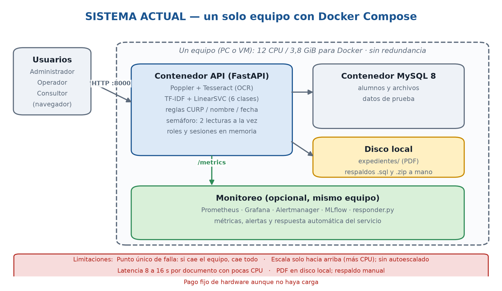 | 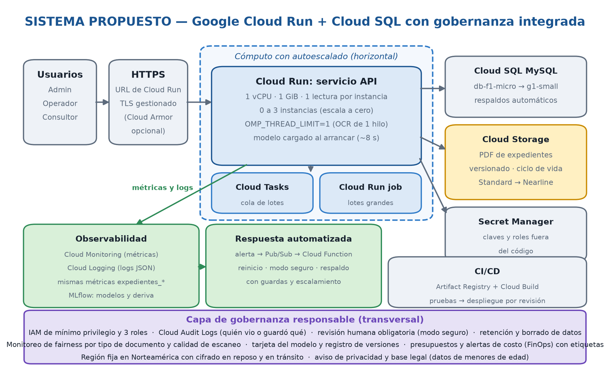 |

| Capa | Tecnología |
|---|---|
| Aplicación e IA | Python 3.11 · FastAPI · Tesseract + Poppler · scikit-learn (TF-IDF + LinearSVC) · Tkinter (escritorio) |
| Datos | MySQL 8 · MLflow (registro de modelos) |
| Observabilidad | Prometheus · Alertmanager · Grafana · logs JSON y trazas · PSI (data drift) |
| Entrega y operación | Docker / Compose · GitHub Actions · GHCR · Trivy · pytest · ruff · GitOps |
| Nube (propuesta) | Cloud Run · Cloud SQL · Cloud Storage |

## 4. Resultados

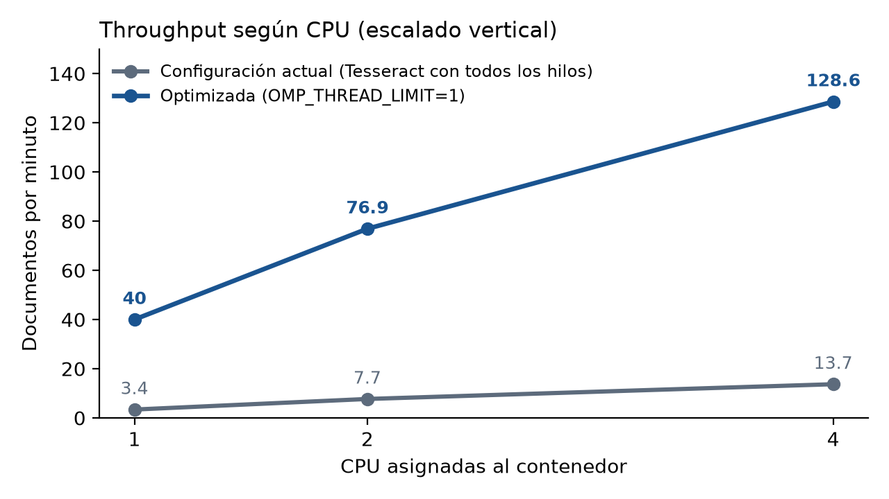

- **Rendimiento:** limitar los hilos de Tesseract (`OMP_THREAD_LIMIT=1`) pasó de 3,7 a 40 documentos por minuto con 1 CPU, con resultados idénticos; la latencia mediana bajó de 15,3 s a 1,4 s.
- **Modelo:** exactitud 97,4 %, F1 macro 0,9735; clase más débil Certificado Parcial (F1 0,934).
- **Operación (simulada):** latencia detectada en 53 s y recuperada en 124 s; deriva de datos detectada en 191 s (PSI de 0,36 a 0,06); base de datos restaurada en 60 s; la API se reinicia sola en 38–43 s con un límite de 3 reinicios y escalamiento.
- **Pipeline:** CI de 4 trabajos en ≈ 2 min; publicación de v1.0.0 en 3 min 34 s; reversión automática comprobada.
- **Auditoría:** sin brecha por sexo; **sesgo de representación** (90 % de las CURP legibles es de una entidad); 3,2 puntos menos de exactitud en formatos poco familiares. La expansión a otros planteles queda condicionada a reunir más datos.

## 5. Evidencias visuales

| | |
|---|---|
| 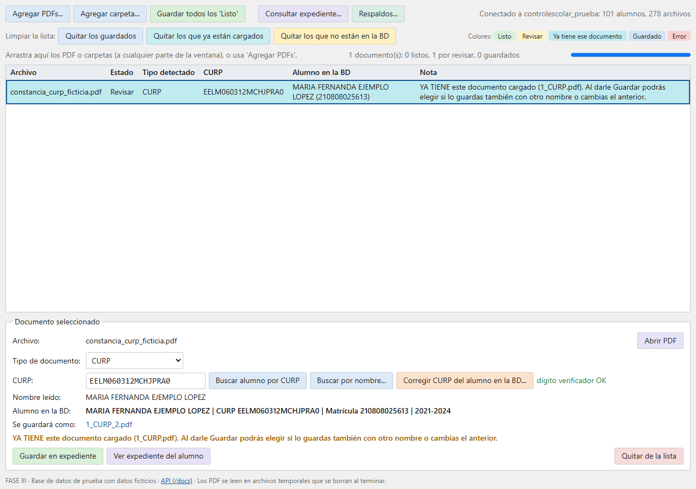 | 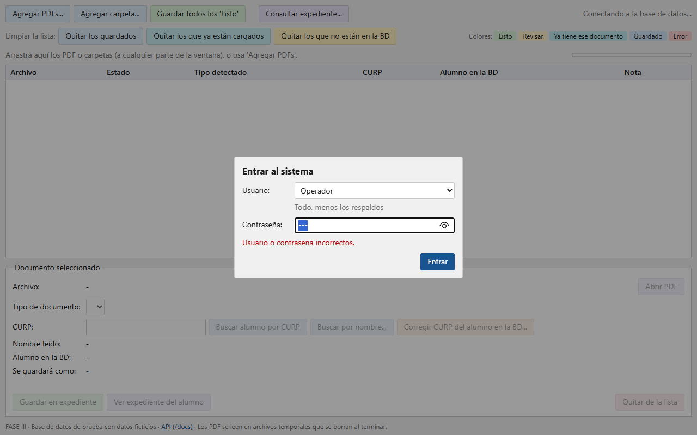 |
| La aplicación: aviso de «ya tiene este documento» | Acceso con tres roles |
| 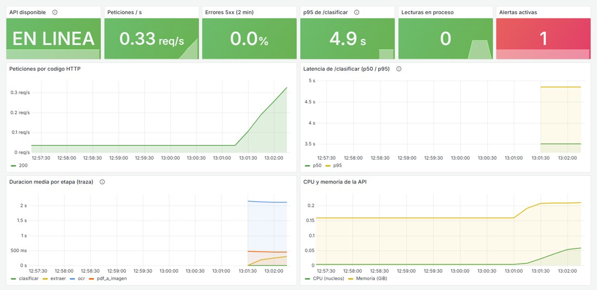 | 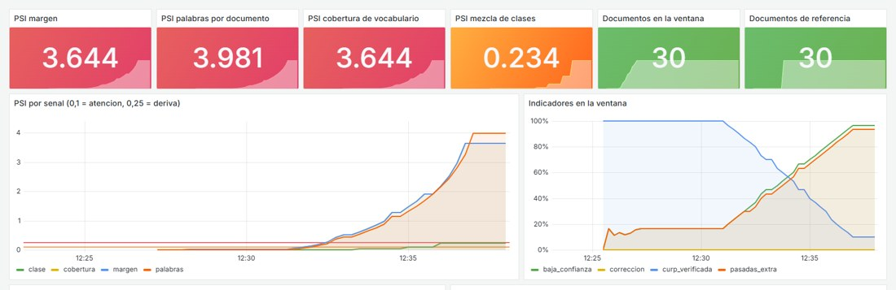 |
| Dashboard de servicio en tiempo real | Data drift con escaneos degradados (simulado) |
| 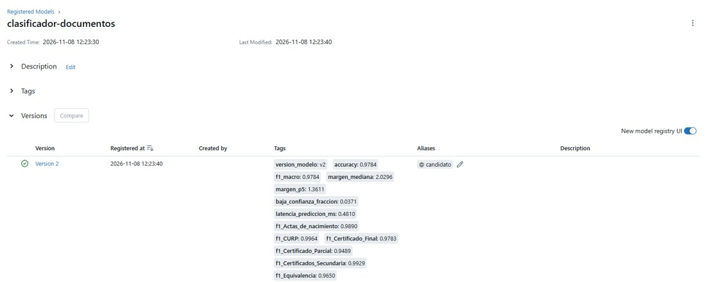 | 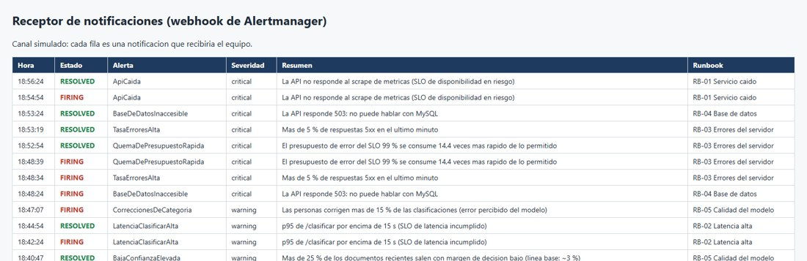 |
| Registro de modelos en MLflow | Notificaciones de alertas con su runbook |
| 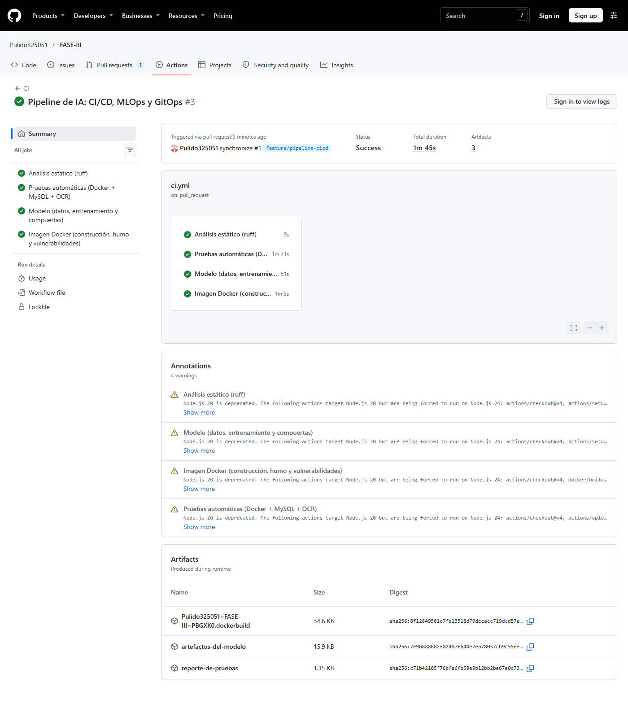 | 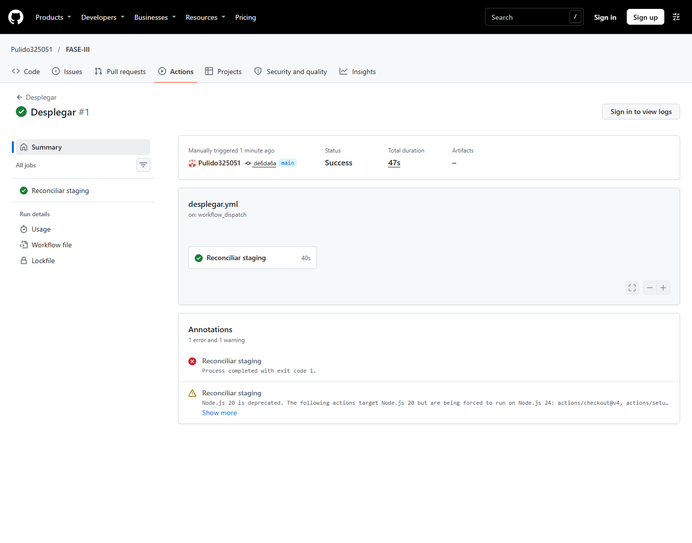 |
| CI en verde (ejecución real) | Despliegue con reversión automática |

## 6. Decisiones estratégicas y aprendizajes

- **Privacidad por diseño:** ningún log, métrica ni traza lleva datos personales; el dataset real no sale de la institución y el pipeline se prueba con datos sintéticos.
- **Una persona siempre revisa:** el modelo propone y la persona decide; ante deriva, el modo seguro obliga a revisar todo. Se automatiza lo reversible.
- **Medir antes de optimizar:** la mejora más grande (×10,8) salió de entender por qué un contenedor con poca CPU iba lento, no de agregar hardware.
- **Auditar y decirlo:** el análisis de fairness encontró un sesgo de representación y se documenta.
- **Entregar como producto:** CI/CD, versionado, compuertas de calidad y reversión.
- **Decir qué es simulado:** los incidentes, el despliegue y los costos de nube son simulaciones o estimaciones y se marcan así.

## 7. Hoja de ruta

| Horizonte | Acción |
|---|---|
| Corto plazo | Proteger la rama `main` con la CI, aviso de privacidad y retención, validar los tiempos de ahorro con Control Escolar |
| Mediano plazo | Piloto en la nube (Cloud Run + Cloud SQL), datos de otros planteles y evaluación por plantel |
| Largo plazo | Reentrenamiento periódico con compuertas, monitoreo de fairness mensual, auditoría anual y conexión a la base real |

## Dónde ver más

[README](../README.md) · [Pipeline y decisiones](PIPELINE.md) · carpetas `monitoreo/`, `escalabilidad/`, `pipeline/` y `despliegue/`.
